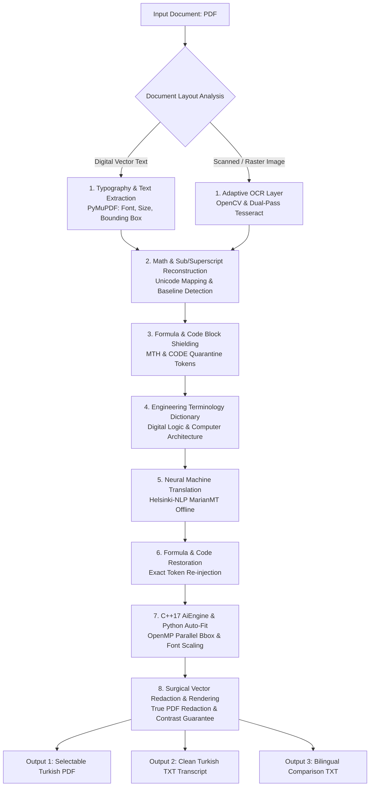

# PDF AI Book & Slide Translator (EN ➔ TR) 🚀

<p align="center">
  <a href="README.md"><b>🇬🇧 English Documentation</b></a> •
  <a href="README_TR.md">🇹🇷 Türkçe Dokümantasyon</a>
</p>

[](https://github.com/Tefezimli/PDF_AI_BOOK-TRANSLATER_ING-TO-TR)
[](https://isocpp.org/)
[](https://www.python.org/)
[](#-obsidian-cyber-workstation-gui)
[](https://developer.nvidia.com/cuda-toolkit)
[](https://www.openmp.org/)
[](#-privacy--security)
[](LICENSE)

> **A high-performance, 100% offline and air-gapped hybrid (C++17 + Python) neural translation workstation engineered for academic textbooks, lecture slides, and technical research papers—preserving mathematical formulas, source code blocks, and complex document layouts with millimeter precision.**

---

<p align="center">
  
</p>

---

## ⚡ Quick Start (Zero Configuration & One-Click Setup)

Designed for seamless out-of-the-box operation on Windows without complex manual setup:

```
┌─────────────────────────────────────────────────────────────────────────────────┐
│  STEP 0:  Download the Project:                                                 │
│           Click the green `<> Code` button on GitHub, select `Download ZIP`,    │
│           and extract the archive (or run `git clone <repo-url>`).              │
├─────────────────────────────────────────────────────────────────────────────────┤
│  STEP 1:  Double-click `Kurulum_Yap.bat`.                                      │
│           * Automatically verifies Python 3.10+ (auto-installs if missing).     │
│           * Detects your GPU (RTX 50 / 40 / 30 / GTX) and installs CUDA PyTorch.│
│           * Downloads the neural model (~1.2 GB) & validates offline lock.     │
├─────────────────────────────────────────────────────────────────────────────────┤
│  STEP 2:  Double-click `Baslat.bat`.                                           │
│           * Self-healing watchdog checks all components and launches the GUI.   │
├─────────────────────────────────────────────────────────────────────────────────┤
│  STEP 3:  Select your English PDF and click "🚀 ÇEVİRİYİ BAŞLAT"!              │
└─────────────────────────────────────────────────────────────────────────────────┘
```

> ⚠️ **Initial Internet Notice:** An active internet connection is required **only once during Step 1** to download open-source neural weights and dependencies. Once setup is verified, the entire workstation operates **100% offline (air-gapped) forever** without sending a single byte outside your machine.

---

## 💻 Developer, API & Server Usage

PDF AI Engine is built with a modular, decoupled architecture. You can integrate it directly into Python backends, headless GPU clusters, or automated translation pipelines:

### 1. Python Programmatic API (Integrate into your App)
You can invoke the translation pipeline directly from any Python application without launching the graphical UI:

```python
from pdf_bridge import run_pipeline

# Run the complete end-to-end pipeline with one call:
run_pipeline(
    input_pdf="academic_textbook.pdf",
    output_pdf="academic_textbook_TR.pdf"
)

# Concurrently produces:
#  1. academic_textbook_TR.pdf          (Searchable & layout-preserved PDF)
#  2. academic_textbook_TR.txt          (Pure Turkish text transcript)
#  3. academic_textbook_TR_INCELEME.txt (Side-by-side bilingual review file)
```

### 2. Headless GPU Server / CLI Execution (Linux & Windows)
Run translation jobs on remote servers, Docker containers, or via SSH:

```bash
# Windows (CLI):
.\ai_env\Scripts\python.exe -c "import pdf_bridge; pdf_bridge.run_pipeline('input.pdf', 'output.pdf')"

# Linux / Docker / Remote GPU Server:
python3 -c "import pdf_bridge; pdf_bridge.run_pipeline('input.pdf', 'output.pdf')"
```

### 3. Hardware Auto-Negotiation Matrix
The neural runtime dynamically inspects host capabilities and selects optimal precision:

| Hardware Architecture | Detected Device | Tensor Precision | Processing Mode |
| :--- | :--- | :---: | :--- |
| **Blackwell (RTX 50xx)** | `NVIDIA GeForce RTX 5080/5090` | `bfloat16` | Ultra-High Speed Tensor Cores |
| **Ada Lovelace (RTX 40xx)** | `NVIDIA GeForce RTX 4070/4080/4090` | `bfloat16` | Hardware Acceleration |
| **Ampere (RTX 30xx)** | `NVIDIA GeForce RTX 3060/3070/3080` | `bfloat16` | Hardware Acceleration |
| **Turing / Pascal (RTX 20xx / GTX)**| `NVIDIA GTX 1060 / 1660 / RTX 2060` | `float16` | Standard GPU Mode |
| **Integrated / No GPU** | `Multi-Threaded CPU Engine` | `float32` | OpenMP CPU Parallelism (`N-1` Threads) |

---

## 🖥️ Obsidian Cyber-Workstation GUI

The native desktop workstation in [`app_gui.py`](app_gui.py) provides a comprehensive suite of visual tools:

* 📁 **Smart Document Picker:** Browse and inspect input PDF documents; automatically displays page count and metadata.
* 👁️ **Dual-Mode Live Page Preview:** Instantly toggle and inspect original English pages against translated Turkish vector pages in real-time.
* 📊 **Live Hardware Telemetry:** Automatically discovers and displays active hardware acceleration (RTX 5080 sm_120 Blackwell, CUDA cores, or multi-threaded CPU fallback).
* 🛡️ **Air-Gapped Protocol Monitor:** Verifies 100% offline isolation and ensures zero data leakage.
* 📝 **Bilingual Review Inspector:** Side-by-side inspection table presenting original English sentences alongside translated Turkish paragraphs with one-click copying.
* ⚡ **Live Progress & Console Logs:** Real-time percentage progress bar and terminal logs detailing OCR, mathematical masking, and C++ layout fitting.

---

## 🛡️ Why PDF AI Engine? (Traditional Translators vs. PDF AI Engine)

<p align="center">
  
</p>

Standard translation tools inevitably break formulas, corrupt code listings, and misalign document geometry:

| Comparison Criteria | Standard Translators (Google / DeepL) | 🚀 PDF AI Engine Pro (v17.0) |
| :--- | :--- | :--- |
| **Mathematics & Formulas** | Corrupts equations into plain text ($x^2 \to x2$, $r^{n-1} \to rn-1$) | 🛡️ **Unicode Super/Subscripts & MTH-Token Shield** preserve formulas 100% |
| **Code & Command Quarantine**| Translates commands and variable names into broken prose | 🔒 **Code Quarantine:** Terminal commands, Ruby, C, and hex offsets remain untouched |
| **Document Layout & Typography** | Drifts text boxes, misaligns tables and diagram callouts | ⚡ **C++17 OpenMP & Dynamic Font Auto-Fit** ensure millimeter-precise alignment |
| **Background Color & Contrast** | Pastes white text boxes over dark slides, ruining aesthetics | 🎨 **Outer-Ring Color Sampling:** White text on dark themes, dark text on light themes |
| **Academic Terminology** | Literal/generic translations (*Radix* $\to$ *Root*) | 📚 **Domain Glossary:** *Radix Complement* $\to$ *Taban Tümleyeni* |
| **Privacy & Security** | Uploads documents to third-party cloud servers | 🔒 **100% Offline (Air-Gapped):** No data ever leaves your local machine |
| **Hardware Flexibility** | Cloud-dependent, limited local control | 🚀 **Universal NVIDIA CUDA (RTX 50/40/30/GTX)** + Autonomous CPU Fallback |
| **Output Flexibility** | Produces only a single PDF output | 📑 **Tri-Output System:** Selectable PDF + Clean TXT + Bilingual Review TXT |

---

## 🏛️ System Architecture & Workflow



### 🔄 8-Stage End-to-End Processing Pipeline:

1. **📄 Document Layout Analysis (DLA):** Classifies pages as digital vector text or raster scanned slides. Digital text is extracted directly via PyMuPDF; scanned slides are processed through OpenCV adaptive thresholding and dual-pass Tesseract OCR.
2. **📐 Math & Index Reconstruction:** Preserves superscripts ($x^2, r^{n-1}$) and subscripts ($a_0, N_1$) at the Unicode character level.
3. **🛡️ Formula & Code Quarantine:** Encapsulates formulas and programming code blocks (`def exploit`, `msfconsole`, hex strings) using non-translatable tokens.
4. **📚 Academic & Engineering Glossary:** Applies deterministic rule-based corrections for computer architecture and digital logic terms (*Radix Complement* $\to$ *Taban Tümleyeni*, *Discard end carry* $\to$ *Son eldeyi atın*).
5. **🧠 Neural Machine Translation:** Runs local MarianMT inference on GPU/CPU with mini-batching and repeat penalty optimizations.
6. **🔓 Token Restoration:** Unmasks shielded tokens back into translated Turkish sentences with zero loss.
7. **⚡ C++17 AiEngine & Dynamic Font Auto-Fit:** Calculates language expansion ratios and iteratively optimizes font size to fit bounding boxes using OpenMP parallel threads.
8. **🎨 Surgical Vector Redaction & Rendering:** Safely erases original English background text while preserving underlying diagrams and line art, rendering sharp Turkish vector glyphs.

---

## 📑 Tri-Output Production System

Every processed document concurrently produces three complementary formats:

1. **Searchable & Selectable Turkish PDF (`*_ULTIMATE.pdf`):** A visual twin of the original document with surgical in-place replacement and selectable vector text.
2. **Clean Turkish Transcript (`*_ULTIMATE.txt`):** A clean page-by-page transcript containing pure Turkish text and reconstructed mathematical formulas.
3. **Bilingual Review File (`*_INCELEME.txt`):** A side-by-side comparative inspection document displaying original English blocks against Turkish translations.

---

## 📁 Repository Directory Structure

```
pdf_ai_engine/
├── assets/                  # Showcase and comparison visual assets
│   ├── app_preview.png      # Obsidian Cyber Workstation GUI preview
│   └── comparison_demo.png  # Before / After academic translation comparison
├── include/                 # C++ Header Files
│   ├── pdf_layout.h         # Document layout and BoundingBox structures
│   ├── tensor.h             # Custom C++ tensor and matrix optimizations
│   └── tokenizer.h          # High-speed word tokenization interface
├── src/                     # C++ Source Files
│   ├── main.cpp             # OpenMP multi-threaded font adaptation engine
│   ├── pdf_layout.cpp       # Layout calculation routines
│   ├── tensor.cpp           # Tensor multiplication logic
│   └── tokenizer.cpp        # C++ tokenizer implementation
├── app_gui.py               # Obsidian Cyber-Workstation desktop GUI (v17.0)
├── pdf_bridge.py            # Core AI, OCR, layout, and rendering engine (v17.0)
├── export_model.py          # MarianMT model exporter to Float32 binary (.bin)
├── Kurulum_Yap.bat          # 1-Click Windows automated setup & GPU installer
├── Baslat.bat               # 1-Click Windows self-healing launcher
├── CMakeLists.txt           # C++ CMake build configuration
├── requirements.txt         # Python package dependencies
├── Giris.txt                # Quick reference cheat-sheet
├── LICENSE                  # MIT License
├── README.md                # Primary English documentation
└── README_TR.md             # Turkish documentation
```

---

## ⚙️ Building C++ AiEngine (Optional / Performance Boost)

```bash
mkdir build
cd build
cmake ..
cmake --build . --config Release
cd ..
```

> ℹ️ **Note:** CMake and C++ compiler are optional. If not installed, `pdf_bridge.py` seamlessly falls back to its built-in Python dynamic font auto-fit algorithm.

---

## ❓ Frequently Asked Questions (FAQ)

<details>
<summary><b>1. Does this work completely offline without internet?</b></summary>
Yes! Once <code>Kurulum_Yap.bat</code> downloads the translation model during initial setup, the application operates 100% offline with zero external network dependencies.
</details>

<details>
<summary><b>2. Can I run this on any NVIDIA card or only RTX 50 series?</b></summary>
It supports <b>all CUDA-enabled NVIDIA GPUs</b> (GTX 10/16 series, RTX 20/30/40/50 series, and Quadro/Tesla cards). If no dedicated GPU is found, it automatically uses your multi-core CPU.
</details>

<details>
<summary><b>3. Does it handle scanned slides and dark-themed presentations?</b></summary>
Yes. Dual-pass adaptive OCR with outer-ring color sampling reliably extracts and renders text across both bright white slides and inverted dark themes.
</details>

<details>
<summary><b>4. Will mathematical formulas, code blocks, and superscripts be corrupted?</b></summary>
No. The MTH & Code Quarantine Token Shields lock all equations and programming syntax prior to translation and restore them intact in their original structure.
</details>

---

## 🔒 Privacy & Security

* **100% Air-Gapped & Local:** No documents, text, or telemetry are ever transmitted to external cloud servers.
* **Hugging Face Telemetry Disabled:** Explicitly disabled in code (`HF_HUB_OFFLINE=1`, `HF_HUB_DISABLE_TELEMETRY=1`).

---

## 📄 License

This project is open-source under the [MIT License](LICENSE). You are free to use, modify, and distribute it.
