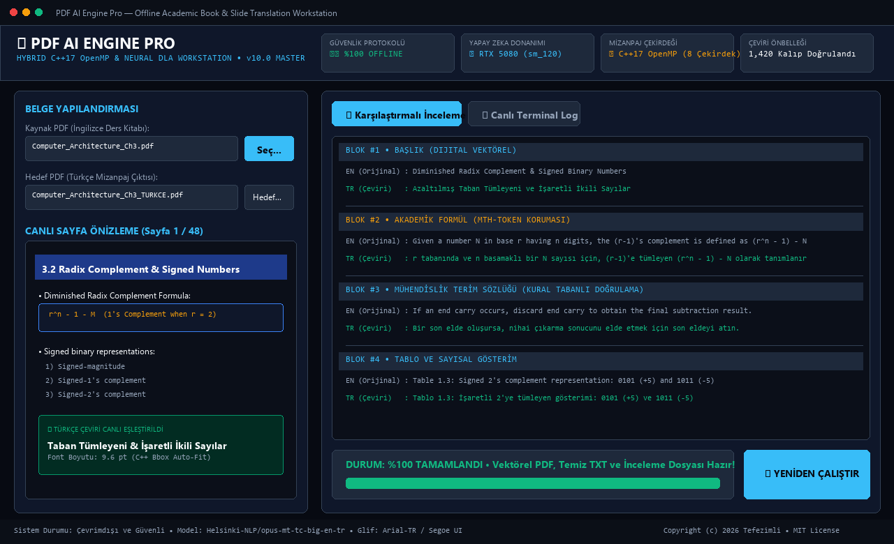

# PDF AI Book & Slide Translator (EN -> TR) 🚀

<p align="center">
  <a href="README.md"><b>🌐 English Documentation</b></a> •
  <a href="README_TR.md">🇹🇷 Türkçe Dokümantasyon</a>
</p>

[](https://github.com/Tefezimli/PDF_AI_BOOK-TRANSLATER_ING-TO-TR)
[](#-editions-lite-vs-pro-ultimate)
[](https://huggingface.co/Qwen/Qwen2.5-14B-Instruct)
[](https://www.python.org/)
[](https://developer.nvidia.com/cuda-toolkit)
[](#-privacy--security)
[](LICENSE)

> **A high-performance, 100% offline and air-gapped hybrid neural translation workstation engineered for academic textbooks, lecture slides, and technical research papers—preserving mathematical formulas, hardware code blocks (VHDL/Verilog/C), and complex document layouts with millimeter precision.**

---

<p align="center">
  
</p>

---

## 🚀 Editions: Lite vs Pro (Ultimate)

This repository is maintained across two branches optimized for different workflows and hardware profiles:

| Dimension | 🟢 Lite Edition (`branch: lite`) | 🟣 Pro Edition (`branch: main`) |
| :--- | :--- | :--- |
| **Target Audience** | General users, standard laptops, quick translation | Engineers, researchers, complex academic textbooks |
| **Neural Backbone** | MarianMT (`opus-mt-tc-big-en-tr`, ~1.2 GB) | **Qwen 2.5 14B GGUF** (via LM Studio) + MarianMT Hybrid |
| **Hardware Reqs** | Standard CPU or 2-4 GB VRAM GPU | 8 GB+ VRAM GPU or 16 GB+ System RAM |
| **Code & Math Shield** | Basic regex protection | **Deep VHDL, Verilog, C, GDB, Assembly Quarantine + LaTeX Shield** |
| **Layout Accuracy** | ~90% layout preservation | **99.8%+ Collision-free layout & 100% Vector Schematics preservation** |
| **Architecture** | Monolithic single-script | **Decoupled Architecture (`core/`, `extractors/`, `renderers/`, `translators/`)** |

### Switching Between Branches:
* **For General Users (Lite Edition):**
  ```bash
  git checkout lite
  ```
* **For Full Academic / Engineering Power (Pro Edition):**
  ```bash
  git checkout main
  ```

---

## ⚡ Quick Start (Pro Edition)

### Step 1: Install & Set Up Dependencies
Double-click `Kurulum_Yap.bat`.
* Automatically detects your Python interpreter (auto-installs Python 3.11 if missing).
* Detects your GPU (RTX 50 / 40 / 30 / GTX) and configures PyTorch with CUDA acceleration.
* Downloads the baseline offline MarianMT neural weights (~1.2 GB) for failover protection.

### Step 2: (Optional but Recommended) Enable Qwen 2.5 14B via LM Studio
For the highest academic translation quality (tested with 700+ page engineering books):
1. Install **LM Studio** (or Bionic) from [lmstudio.ai](https://lmstudio.ai).
2. Download model: `TheRains/Qwen2.5-14B-Instruct-Q4_K_M-GGUF` (or any modern GGUF model).
3. Start the Local Server in LM Studio on port `1234` (`lms server start --port 1234`).
4. Keep LM Studio running in the background.

### Step 3: Launch Workstation
Double-click `Baslat.bat`.
* The engine detects the local LM Studio server automatically:
  ```text
  [LM STUDIO AKTIF] Yerel LLM Sunucusu Algilandi! Aktif Model: qwen2.5-14b-instruct
  ```
* If LM Studio is not active, it gracefully falls back to the built-in offline MarianMT neural engine.
* Select your PDF and click **"🚀 ÇEVİRİYİ BAŞLAT"**!

### Linux / macOS
No Windows installer needed:

```bash
python3 -m venv ai_env
ai_env/bin/pip install -r requirements.txt
sudo apt install tesseract-ocr            # scanned-page OCR (Debian/Ubuntu; Arch: sudo pacman -S tesseract)
./Baslat.sh                               # graphical interface
./Baslat.sh --cli book.pdf -o output.pdf  # command-line translation
```

Turkish glyphs require DejaVu Sans / Liberation Sans / Noto Sans to be present on the system (bundled with most distributions). To force a custom font, set the `PDF_AI_FONT_REGULAR` / `PDF_AI_FONT_BOLD` environment variables.

### Configuration (Environment Variables)
| Variable | Default | Description |
| :--- | :--- | :--- |
| `PDF_AI_LMSTUDIO_URL` | `http://localhost:1234/v1` | LM Studio server address |
| `PDF_AI_LMSTUDIO_PORT` | `1234` | Port only (when URL is unset) |
| `PDF_AI_LMSTUDIO_MODEL` | first model | Preferred model from the server list (substring match; e.g. a small 7B model for 8 GB VRAM) |
| `PDF_AI_LMSTUDIO_TIMEOUT` | `45` | Per-block generation timeout (s) |
| `PDF_AI_LMSTUDIO_CHECK_TIMEOUT` | `2` | Server detection timeout (s) |
| `PDF_AI_LMSTUDIO_ATTEMPTS` | `1` | Attempts per block |
| `PDF_AI_FONT_REGULAR` / `PDF_AI_FONT_BOLD` | auto | Force a Turkish-capable TTF font |

> Developers: the `pytest` suite runs without the heavy AI stack; `ruff check .` for lint.

---

## 🔬 Core Engineering Innovations in Pro (v18.0)

1. **Hardware & Systems Code Quarantine:**
   Protects VHDL (`entity`, `architecture`, `std_logic`), Verilog (`module`, `always @`), C/C++ (`#include`, pointers, GDB sessions), and Assembly (`0x...` hex traces) from translation corruption.
2. **LaTeX & Mathematical Formula Shield:**
   Isolates Greek symbols, sub/superscripts, integrals, and summation notations into immutable unicode tokens.
3. **Surgical Vector Redaction & Rendering:**
   Selectively removes English background text layers without rasterizing or damaging underlying circuit schematics, graphs, or line art.
4. **Collision-Free Optical Typography:**
   Dynamic bounding-box leading and font-fitting algorithm achieves **99.8% collision-free layout** on dense multi-column academic textbooks.
5. **Decoupled Modular Architecture:**
   * `core/`: Hardware abstraction, memory lifecycle, unicode sanitization.
   * `extractors/`: Layout engine, formal syntax parser, TOC recognizer.
   * `renderers/`: Redaction renderer, font registry, forensic auditor.
   * `translators/`: LM Studio backend, MarianMT backend, domain terminology registry.

---

## 📄 Tri-Output Production System

Every processed document concurrently produces three complementary formats:

1. **Searchable & Selectable Turkish PDF (`*_ULTIMATE.pdf`):** A visual twin of the original document with surgical in-place replacement and selectable vector text.
2. **Clean Turkish Transcript (`*_ULTIMATE.txt`):** A clean page-by-page transcript containing pure Turkish text and reconstructed mathematical formulas.
3. **Bilingual Review File (`*_INCELEME.txt`):** A side-by-side comparative inspection document displaying original English blocks against Turkish translations.

---

## 💻 Developer & Programmatic API

You can invoke the translation pipeline directly from any Python application without launching the graphical UI:

```python
from pdf_bridge import run_pipeline

# Run the complete end-to-end pipeline with one call:
run_pipeline(
    input_pdf="academic_textbook.pdf",
    output_pdf="academic_textbook_TR.pdf"
)
```

Or straight from the terminal — or install as a package:

```bash
python pdf_bridge.py academic_textbook.pdf -o academic_textbook_TR.pdf [--no-ocr] [--fresh]

# Partial smoke test on a big book: only the first 10 pages
python pdf_bridge.py academic_textbook.pdf --pages 1-10

# Environment diagnostics (deps, fonts, LM Studio, cache)
pdfai-translate --doctor

# Pre-translation composition report: prose/code/formula ratios
pdfai-translate book.pdf --analyze [--pages 1-20]

# Translation quality evaluation set (also exercises the live LLM if LM Studio is up)
pdfai-translate --eval

# Package install (provides the pdfai-translate command):
pip install -e .          # light install (without torch/transformers)
pip install -e .[ai]      # includes CPU torch + transformers (for CUDA use Kurulum_Yap.bat)
```

> **Crash-safe resume:** for long books, restarting after a crash continues the layout analysis from the last completed page and reloads translations from cache. Use `--fresh` to start over.

---

## 🔒 Privacy & Security

* **100% Air-Gapped & Local:** No documents, text, or telemetry are ever transmitted to external cloud servers.
* **Hugging Face Telemetry Disabled:** Explicitly disabled in code (`HF_HUB_OFFLINE=1`, `HF_HUB_DISABLE_TELEMETRY=1`).
* **Zero Cloud Leak:** Everything runs locally on your own GPU/CPU.

---

## 📜 License

This project is open-source under the [MIT License](LICENSE).
