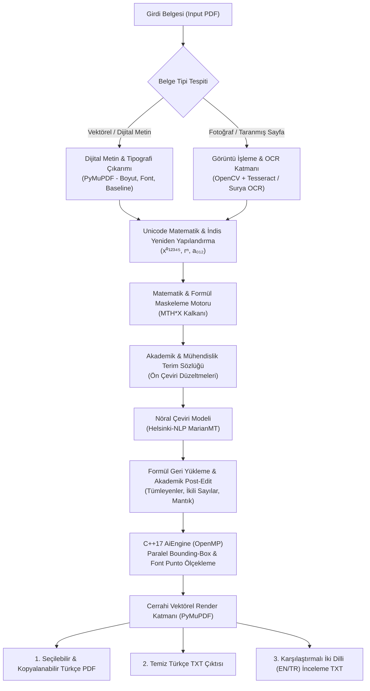

# PDF AI Book Translator (EN -> TR) 🚀

[](https://isocpp.org/)
[](https://www.python.org/)
[](https://pytorch.org/)
[](https://www.openmp.org/)
[](#)
[](LICENSE)

> **Açık kaynaklı, tamamen yerel ve internetsiz akademik PDF çeviri motoru.**  
> Python ve C++ mimarisiyle çalışan bu araç, Belge Düzeni Analizi (DLA) kullanarak ders kitaplarındaki matematik formüllerini, grafikleri ve mizanpajı bozmadan İngilizceden Türkçeye çevirir. Yüksek gizlilik odaklı, güvenli ve donanım dostudur.

---

## 📋 Genel Bakış (Overview)

**PDF AI Book Translator**, akademik kitaplar, teknik dokümanlar ve ders notları gibi karmaşık mizanpajlı belgeleri biçimini ve formüllerini koruyarak İngilizceden Türkçeye çevirmek üzere tasarlanmış hibrit bir yapay zekâ motorudur. 

Geleneksel çeviri araçlarının mizanpajı bozması, formülleri anlamsız metinlere çevirmesi ve bulut bağımlılığı nedeniyle gizlilik riskleri oluşturması sorunlarını **tamamen yerel çalışan çift çekirdekli (C++17 + Python) bir mimariyle** çözer.

---

## 🏛️ Mimari ve İş Akışı (Architecture Workflow)



---

## ✨ Temel Yetenekler ve Teknik Yenilikler

### 1. ⚡ Hibrit C++17 & Python Çekirdeği
- **C++17 (OpenMP)**: Türkçe metinlerin İngilizceye kıyasla uzama katsayılarını paralel izleklerle (multi-threading) hesaplar ve font puntonu milimetrik olarak optimize eder.
- **Python Orkestrasyonu**: Belge düzeni analizi, OCR, PyMuPDF entegrasyonu ve Hugging Face dönüştürücülerini koordine eder.

### 2. 🛡️ Matematik, Formül ve Üst/Alt İndis Koruma Kalkanı
- Akademik metinlerdeki **üst simgeler** (`x²`, `rⁿ⁻¹`) ve **alt simgeler** (`a₀`, `N₁`) Unicode seviyesinde korunur.
- Denklemler ve formüller çeviri öncesinde özel jetonlarla (`MTH0X`, `MTH1X`) maskelenir; çeviri sonrasında hiçbir semantik bozulma olmadan orijinal matematik formatında geri yerleştirilir.

### 3. 📚 Bütünleşik Akademik ve Mühendislik Sözlüğü
- Mantık devreleri, sayısal tasarım, bilgisayar mimarisi ve matematik terimleri için özel olarak eğitilmiş/kural tabanlı sözlük motoru:
  - `Radix Complement` $\rightarrow$ *Taban Tümleyeni*
  - `Diminished Radix Complement` $\rightarrow$ *Azaltılmış Taban Tümleyeni*
  - `Signed Binary Numbers` $\rightarrow$ *İşaretli İkili Sayılar*
  - `Discard end carry` $\rightarrow$ *Son eldeyi atın*
  - `Minuend / Subtrahend` $\rightarrow$ *Eksilen / Çıkan*

### 4. 🚀 Donanım Hızlandırması & Yeni Nesil GPU Desteği
- **NVIDIA Blackwell & RTX 5080 (sm_120)** desteği: CUDA 12.8+, TF32 ve FP16/BF16 Tensör Çekirdeklerini otomatik olarak etkinleştirir.
- **CPU Fallback Protokolü**: CUDA veya GPU bulunamadığında sistem kilitlenmez; çok çekirdekli işlemci izleklerini (Multi-threaded CPU) devreye sokarak işlemi kesintisiz tamamlar.

### 5. 📑 Üçlü Çıktı Üretimi (Tri-Output System)
1. **Seçilebilir / Kopyalanabilir PDF**: Eski İngilizce metin cerrahi olarak temizlenir, Türkçe metin aynı koordinatlara kusursuz bir şekilde yerleştirilir (Fareyle seçilebilir ve kopyalanabilir vektörel katman).
2. **Temiz Türkçe TXT (`*_ULTIMATE.txt`)**: Sayfa sayfa bölünmüş, metin ve formülleri içeren salt Türkçe transkript.
3. **Karşılaştırmalı İnceleme TXT (`*_INCELEME.txt`)**: Blok blok İngilizce orijinal ve Türkçe çeviriyi yan yana sunan akademik kontrol dosyası.

---

## 📁 Proje Dizin Yapısı

```
pdf_ai_engine/
├── include/                 # C++ Başlık Dosyaları
│   ├── pdf_layout.h         # Belge düzeni ve sınırlayıcı kutu (bbox) yapıları
│   ├── tensor.h             # Özel C++ Tensör matris işlemleri
│   └── tokenizer.h          # Hızlı kelime ayrıştırma (tokenizer) arayüzü
├── src/                     # C++ Kaynak Kodları
│   ├── main.cpp             # OpenMP çok çekirdekli font adaptasyon motoru
│   ├── pdf_layout.cpp       # Düzen hesaplama fonksiyonları
│   ├── tensor.cpp           # Matris çarpımı ve tensör mantığı
│   └── tokenizer.cpp        # Tokenizer uygulaması
├── CMakeLists.txt           # C++ projesi derleme konfigürasyonu
├── requirements.txt         # Python kütüphane bağımlılıkları
├── pdf_bridge.py            # Ana iş akışını, OCR'ı ve çeviriyi yöneten Python köprüsü
├── export_model.py          # MarianMT model ağırlıklarını C++ için ikili (.bin) formata dönüştürücü
├── Giris.txt                # Hızlı başlangıç komutları
└── README.md                # Proje dokümantasyonu
```

---

## 🛠️ Kurulum ve Hazırlık

### Gereksinimler
- **C++ Derleyicisi**: C++17 ve OpenMP destekli (MSVC, GCC veya Clang)
- **CMake**: >= 3.10
- **Python**: >= 3.10
- **Tesseract OCR**: Windows için varsayılan yol `C:\Program Files\Tesseract-OCR\tesseract.exe` (farklıysa `pdf_bridge.py` içinden güncellenebilir).

### 1. Python Sanal Ortamını Kurun
```bash
# Sanal ortam oluşturun
python -m venv ai_env

# Sanal ortamı aktif edin
ai_env\Scripts\activate       # Windows
# source ai_env/bin/activate  # Linux / macOS

# Gerekli paketleri yükleyin
pip install -r requirements.txt
```

> **RTX 50 Serisi (Blackwell / sm_120) GPU Kullanıcıları İçin:**
> ```bash
> pip install --pre torch torchvision --index-url https://download.pytorch.org/whl/nightly/cu128
> ```

### 2. C++ AiEngine Motorunu Derleyin
```bash
mkdir build
cd build
cmake ..
cmake --build . --config Release
cd ..
```

---

## 🚦 Kullanım (Usage)

### 1. Modeli Dışa Aktarma (İsteğe Bağlı)
MarianMT kelime gömme (embedding) matrislerini saf Float32 binary (.bin) olarak derlemek isterseniz:
```bash
python export_model.py
```

### 2. Çeviri ve Mizanpaj İş Hattını Çalıştırma
Belgenizi işlemek için `pdf_bridge.py` dosyasını çalıştırın:
```bash
python pdf_bridge.py
```

İşlem tamamlandığında çalışma dizininde 3 dosya üretilecektir:
- `cevirilmis_belge_ULTIMATE.pdf` (Metinleri seçilebilir, formatı korunmuş Türkçe PDF)
- `cevirilmis_belge_ULTIMATE.txt` (Kopyalanabilir temiz Türkçe metin ve formüller)
- `cevirilmis_belge_ULTIMATE_INCELEME.txt` (EN/TR blok karşılaştırmalı kontrol dosyası)

---

## 🔒 Gizlilik ve Güvenlik
- Bu yazılım **tamamen çevrimdışı (offline)** çalışır.
- Hugging Face telemetri ve token izleyicileri otomatik olarak devre dışı bırakılır.
- Belgeleriniz ve verileriniz asla harici bir sunucuya ya da bulut servisine aktarılmaz.

---

## 📄 Lisans
Bu proje [MIT Lisansı](LICENSE) kapsamında lisanslanmıştır.
