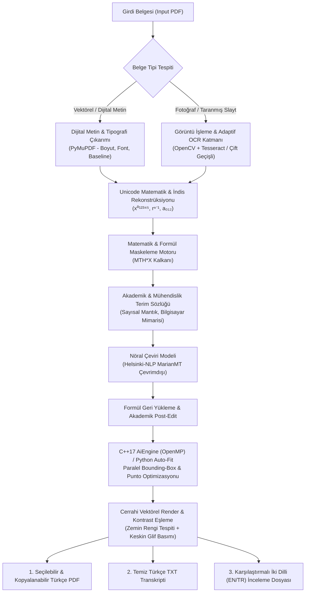

# PDF AI Book & Slide Translator (EN ➔ TR) 🚀

[](https://isocpp.org/)
[](https://www.python.org/)
[](#-modern-grafik-arayüz-obsidian-cyber-workstation)
[](https://pytorch.org/)
[](https://www.openmp.org/)
[](#-gizlilik-ve-güvenlik)
[](LICENSE)

> **Akademik kitaplar, ders slaytları ve teknik makaleler için formülleri ve mizanpajı milimetrik koruyan, %100 yerel ve çevrimdışı hibrit (C++17 + Python) yapay zekâ çeviri iş istasyonu.**

---

## ⚡ Hızlı Başlangıç (Hiçbir Şey Bilmeyenler İçin Tek Tıkla Çalıştırma)

Bu uygulamayı bilgisayarınızda çalıştırmak için karmaşık kodlar yazmanıza ya da teknik bilgiye ihtiyacınız yoktur. Sadece aşağıdaki adımları takip edin:

```
┌─────────────────────────────────────────────────────────────────────────────────┐
│  1. ADIM:  Kurulum_Yap.bat dosyasına çift tıklayın.                            │
│            (Tüm yapay zekâ kütüphanelerini, CUDA desteğini ve çeviri modelini   │
│            otomatik olarak kurar. İşlem bitene kadar bekleyin.)                 │
├─────────────────────────────────────────────────────────────────────────────────┤
│  2. ADIM:  Baslat.bat dosyasına çift tıklayın.                                 │
│            (Şık ve modern masaüstü grafik arayüzü doğrudan ekranınıza açılır.)  │
├─────────────────────────────────────────────────────────────────────────────────┤
│  3. ADIM:  "Seç..." butonuyla İngilizce PDF'inizi seçin ve                      │
│            "🚀 ÇEVİRİYİ BAŞLAT" butonuna basın!                                │
└─────────────────────────────────────────────────────────────────────────────────┘
```

> 💡 **Not:** İlk kurulum tamamlandıktan sonra bilgisayarınızın **interneti tamamen kapalı olsa bile** uygulama kusursuzca çalışmaya devam eder!

---

## 💻 Geliştiriciler & Terminal Severler İçin (Manuel Başlatma)

Uygulamayı komut satırı üzerinden yönetmek isterseniz:

### Windows (PowerShell / CMD)
```powershell
# 1. Sanal ortamı aktif edin
.\ai_env\Scripts\activate

# 2. Grafik Arayüzü başlatın:
python app_gui.py

# VEYA doğrudan komut satırından çeviri motorunu çalıştırın:
python pdf_bridge.py
```

### Linux / macOS
```bash
# 1. Sanal ortam oluşturup aktif edin
python3 -m venv ai_env
source ai_env/bin/activate

# 2. Gereksinimleri yükleyin
pip install -r requirements.txt

# 3. Arayüzü başlatın
python3 app_gui.py
```

---

## 🖥️ Modern Grafik Arayüz (Obsidian Cyber-Workstation)

`app_gui.py` ile sunulan masaüstü stüdyosu, çeviri sürecini baştan sona görselleştiren profesyonel araçlarla donatılmıştır:

* 📁 **Akıllı Belge Seçici:** Kaynak PDF'i ve çıktı yolunu kolayca belirleyin; sayfa sayısı ve dosya detayları anında listelenir.
* 👁️ **Canlı Çift Yönlü Sayfa Önizleme:** Çeviri esnasında veya sonrasında orijinal İngilizce sayfa ile çevrilmiş Türkçe sayfayı tek tıkla yan yana karşılaştırın.
* 📊 **Canlı Donanım Telemetrisi:** Sisteminizdeki donanımı (NVIDIA RTX 5080 / Blackwell sm_120, CUDA çekirdekleri veya çok çekirdekli CPU) otomatik tanır ve durumunu gösterir.
* 🛡️ **Hava Boşluğu (Air-Gapped) Göstergesi:** %100 çevrimdışı çalışma kilidini ve sıfır veri sızıntısı protokolünü doğrular.
* 📝 **İki Dilli Karşılaştırma Sekmesi (Bilingual Review):** Orijinal paragraf ile Türkçe çeviriyi blok blok yan yana sunar; doğrudan seçip kopyalayabilirsiniz.
* ⚡ **Canlı İlerleme Çubuğu ve Konsol Terminali:** OCR, formül maskeleme ve C++ mizanpaj adımlarını yüzdelik dilimlerle anlık olarak takip edin.

---

## 🛡️ Neden Bu Proje? (Geleneksel Çeviriler vs. PDF AI Engine)

Standart çeviri yazılımları akademik ve teknik dokümanlarda genellikle yetersiz kalır. Aşağıdaki tablo projenin getirdiği farkları özetlemektedir:

| Özellik / Kriter | Standart Çeviri Araçları (Google Translate / DeepL) | 🚀 PDF AI Engine Pro (v10.0) |
| :--- | :--- | :--- |
| **Matematik ve Denklemler** | Formülleri metne çevirip bozar ($x^2 \to x2$, $r^{n-1} \to rn-1$) | 🛡️ **Unicode Üst/Alt İndis ve MTH Token Kalkanı** ile formülleri %100 korur |
| **Sayfa Mizanpajı & Tipografi** | Metin kutularını, tabloları ve grafik altı yazılarını kaydırır | ⚡ **C++17 OpenMP ve Dinamik Font Sığdırma** ile milimetrik yerleşim sağlar |
| **Zemin Rengi & Kontrast** | Koyu slaytlarda beyaz kutu yapıştırıp görseli çirkinleştirir | 🎨 **Dış Halka Renk Örnekleme:** Koyu zemine beyaz, açık zemine koyu yazı yerleştirir |
| **Akademik Terminoloji** | Genel/sözlük çevirisi yapar (*Radix* $\to$ *Kök*) | 📚 **Bütünleşik Terim Sözlüğü:** *Radix Complement* $\to$ *Taban Tümleyeni* |
| **Gizlilik & Güvenlik** | Dokümanlarınızı harici bulut sunucularına yükler | 🔒 **%100 Çevrimdışı (Air-Gapped):** Hiçbir veri bilgisayarınızın dışına çıkmaz |
| **Donanım Optimizasyonu** | Donanım hızlandırması sınırlıdır | 🚀 **RTX 5080 (CUDA 12.8 / sm_120) Tensör Çekirdeği** + Çok çekirdekli CPU Fallback |
| **Çıktı Çeşitliliği** | Sadece tek bir PDF çıktısı verir | 📑 **3'ü 1 Arada Çıktı:** Seçilebilir PDF + Temiz TXT + İki Dilli Karşılaştırmalı TXT |

---

## 🏛️ Mimari ve İş Akışı (Architecture Workflow)



---

## 📑 Üretilen 3'ü 1 Arada Çıktılar (Tri-Output System)

Bir belge işlendiğinde sistem eşzamanlı olarak 3 farklı formatta çıktı üretir:

1. **Kusursuz Türkçe PDF (`*_ULTIMATE.pdf`):**  
   Orijinal belgenin birebir görsel ikizidir. Eski İngilizce yazılar milimetrik olarak silinip yerine aynı renk ve hizalamada Türkçe çevirileri yerleştirilir. Metinler fareyle seçilebilir, aranabilir ve kopyalanabilir.
2. **Temiz Türkçe Transkript (`*_ULTIMATE.txt`):**  
   Kitap veya slaytların sayfa sayfa bölünmüş, tüm metin ve formüllerini içeren yalın Türkçe metin dökümü.
3. **Karşılaştırmalı İnceleme Dosyası (`*_INCELEME.txt`):**  
   Her bir paragrafın İngilizce orijinali ile Türkçe çevirisini yan yana gösteren akademik denetim ve çalışma kılavuzu.

---

## 📁 Proje Dizin Yapısı

```
pdf_ai_engine/
├── include/                 # C++ Başlık Dosyaları
│   ├── pdf_layout.h         # Belge düzeni ve sınırlayıcı kutu (BoundingBox) yapıları
│   ├── tensor.h             # Özel C++ Tensör ve matris optimizasyonları
│   └── tokenizer.h          # Yüksek hızlı kelime ayrıştırma arayüzü
├── src/                     # C++ Kaynak Kodları
│   ├── main.cpp             # OpenMP çok çekirdekli font adaptasyon motoru
│   ├── pdf_layout.cpp       # Düzen ve font hesaplama uygulamaları
│   ├── tensor.cpp           # Tensör çarpım mantığı
│   └── tokenizer.cpp        # C++ tokenizer uygulaması
├── app_gui.py               # Obsidian Cyber-Workstation masaüstü grafik arayüzü
├── pdf_bridge.py            # Ana yapay zekâ, OCR, mizanpaj ve render iş motoru
├── export_model.py          # MarianMT model ağırlıklarını Float32 ikili (.bin) formata dönüştürücü
├── Kurulum_Yap.bat          # Windows için tek tıkla otomatik kurulum sihirbazı
├── Baslat.bat               # Windows için tek tıkla grafik arayüz başlatıcı
├── CMakeLists.txt           # C++ projesi derleme konfigürasyonu
├── requirements.txt         # Gerekli Python kütüphaneleri
├── Giris.txt                # Hızlı komut referansı
├── LICENSE                  # MIT Lisansı
└── README.md                # Kapsamlı proje dokümantasyonu
```

---

## ⚙️ C++ AiEngine Motorunu Derleme (İsteğe Bağlı)

Sistemde CMake ve C++17 derleyicisi (MSVC / GCC / Clang) yüklüyse, çok çekirdekli C++ OpenMP motorunu derleyerek ekstra hız kazanabilirsiniz:

```bash
mkdir build
cd build
cmake ..
cmake --build . --config Release
cd ..
```

> ℹ️ **Not:** Bilgisayarınızda C++ derleyicisi veya CMake olmasa bile sistem durmaz; `pdf_bridge.py` içindeki dahili Python dinamik font adaptasyon motoru otomatik devreye girer.

---

## ❓ Sıkça Sorulan Sorular (SSS)

<details>
<summary><b>1. İnternetim yokken bu program çalışır mı?</b></summary>
Evet! <code>Kurulum_Yap.bat</code> çalıştırıldığında gerekli çeviri modeli yerel diskinize kaydedilir. Sonrasında bilgisayarınızın ağ bağlantısını tamamen kesseniz bile program %100 çevrimdışı çalışır.
</details>

<details>
<summary><b>2. NVIDIA ekran kartım yok, programı çalıştırabilir miyim?</b></summary>
Kesinlikle evet. Program donanımınızı otomatik algılar. NVIDIA GPU bulamazsa kilitlenmez; çok çekirdekli işlemcinizi (CPU Multi-threading) devreye sokarak işlemi başarıyla tamamlar.
</details>

<details>
<summary><b>3. Taranmış (fotoğraf formatında) slaytlarda çalışır mı?</b></summary>
Evet. Çift geçişli Tesseract OCR ve adaptif görüntü filtreleme katmanı sayesinde hem beyaz zeminli hem de koyu temalı fotoğraflı slaytları yüksek doğrulukla okuyup çevirir.
</details>

<details>
<summary><b>4. Kitaplardaki matematik formülleri bozulur mu?</b></summary>
Hayır. Gelişmiş MTH Token Kalkanı, matematik denklemlerini ve üst/alt indisleri çeviri öncesinde kilitler ve çeviri sonrasında orijinal yapısında geri yükler.
</details>

---

## 🔒 Gizlilik ve Güvenlik

* Bu yazılım **tamamen yerel ve kapalı devre (Air-Gapped)** çalışır.
* Hugging Face telemetri ve token izleyicileri kod seviyesinde engellenmiştir.
* Belgeleriniz, kitaplarınız veya kişisel verileriniz hiçbir koşulda harici bir sunucuya ya da bulut hizmetine aktarılmaz.

---

## 📄 Lisans

Bu proje [MIT Lisansı](LICENSE) kapsamında açık kaynak olarak lisanslanmıştır. Dilediğiniz gibi kullanabilir, geliştirebilir ve özelleştirebilirsiniz.
