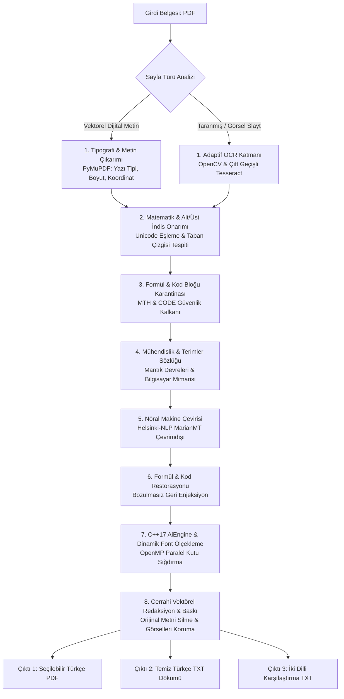

# PDF AI Book & Slide Translator (EN ➔ TR) 🚀

<p align="center">
  <a href="README.md">🇬🇧 English Documentation</a> •
  <a href="README_TR.md"><b>🇹🇷 Türkçe Dokümantasyon</b></a>
</p>

[](https://github.com/Tefezimli/PDF_AI_BOOK-TRANSLATER_ING-TO-TR)
[](https://isocpp.org/)
[](https://www.python.org/)
[](#-modern-grafik-arayüz-obsidian-cyber-workstation)
[](https://developer.nvidia.com/cuda-toolkit)
[](https://www.openmp.org/)
[](#-gizlilik-ve-güvenlik)
[](LICENSE)

> **Akademik kitaplar, ders slaytları ve teknik makaleler için formülleri, kod bloklarını ve mizanpajı milimetrik koruyan, %100 yerel ve çevrimdışı çalışan hibrit (C++17 + Python) yapay zekâ çeviri iş istasyonu.**

---

<p align="center">
  
</p>

---

## ⚡ Hızlı Başlangıç (Sıfır Yapılandırma & Tek Tıkla Kurulum)

Uygulama, sıfır yapılandırma ile (out-of-the-box) çalışacak şekilde tasarlanmıştır. Karmaşık ortam ayarlarıyla uğraşmadan hemen kullanmaya başlayabilirsiniz:

```
┌─────────────────────────────────────────────────────────────────────────────────┐
│  0. ADIM:  Projeyi İndirin:                                                     │
│            GitHub sayfasındaki yeşil `<> Code` butonuna basıp `Download ZIP`    │
│            deyin ve klasöre çıkartın (veya `git clone` yapın).                  │
├─────────────────────────────────────────────────────────────────────────────────┤
│  1. ADIM:  Kurulum_Yap.bat dosyasına çift tıklayın.                            │
│            * Python 3.10+ ortamını denetler (yoksa otomatik kurar).             │
│            * Ekran kartınızı (RTX 50 / 40 / 30 / GTX) algılar ve CUDA kurar.   │
│            * Yapay zeka modelini (~1.2 GB) indirir ve çevrimdışı kilitler.     │
├─────────────────────────────────────────────────────────────────────────────────┤
│  2. ADIM:  Baslat.bat dosyasına çift tıklayın.                                 │
│            * Otomatik sistem denetimini yapar ve masaüstü arayüzünü açar.       │
├─────────────────────────────────────────────────────────────────────────────────┤
│  3. ADIM:  "Seç..." butonuyla İngilizce PDF'inizi belirleyin ve                 │
│            "🚀 ÇEVİRİYİ BAŞLAT" butonuna tıklayın!                              │
└─────────────────────────────────────────────────────────────────────────────────┘
```

> ⚠️ **İlk Kurulum İnternet Notu:** Sadece **1. Adım** sırasında açık kaynaklı yapay zeka modelinin ağırlıklarını (~1.2 GB) ve paketleri indirmek için bir kerelik internet bağlantısı gerekir. Kurulum tamamlandıktan sonra program sonsuza kadar **%100 internetsiz (air-gapped)** olarak çalışır; bilgisayarınızdan tek bir bayt dahi dışarı çıkmaz.

---

## 💻 Geliştirici, API ve Sunucu Kullanımı

PDF AI Engine, modüler ve gevşek bağlı (loosely coupled) bir mimariye sahiptir. Grafik arayüze ihtiyaç duymadan doğrudan kendi Python projelerinize veya sunucu iş akışlarınıza entegre edebilirsiniz:

### 1. Python Programatik API (Kendi Uygulamanıza Entegre Edin)
Herhangi bir Python betiğinden veya arka uç servisinden çeviri motorunu tek satırla çağırabilirsiniz:

```python
from pdf_bridge import run_pipeline

# Tüm çeviri boru hattını doğrudan tetikleyin:
run_pipeline(
    input_pdf="akademik_kitap.pdf",
    output_pdf="akademik_kitap_TR.pdf"
)

# Eş zamanlı olarak 3 çıktı üretilir:
#  1. akademik_kitap_TR.pdf          (Metni seçilebilir, kusursuz mizanpajlı PDF)
#  2. akademik_kitap_TR.txt          (Temiz Türkçe metin dökümü)
#  3. akademik_kitap_TR_INCELEME.txt (İki dilli yan yana karşılaştırma dosyası)
```

### 2. Headless GPU Sunucu & Terminalden Çalıştırma (Linux & Windows)
Grafik arayüzü olmayan uzak sunucularda, Docker konteynerlerinde veya SSH üzerinde çalıştırmak için:

```bash
# Windows (Komut Satırı / PowerShell):
.\ai_env\Scripts\python.exe -c "import pdf_bridge; pdf_bridge.run_pipeline('kitap.pdf', 'kitap_TR.pdf')"

# Linux / Docker / Uzak GPU Sunucusu:
python3 -c "import pdf_bridge; pdf_bridge.run_pipeline('kitap.pdf', 'kitap_TR.pdf')"
```

### 3. Donanım Otomatik Uyumluluk Matrisi
Motor, donanımınızı dinamik olarak analiz eder ve en yüksek verimi sağlayacak modu otonom seçer:

| Donanım Mimarisi | Algılanan Aygıt | Tensör Hassasiyeti | İşleme Modu |
| :--- | :--- | :---: | :--- |
| **Blackwell (RTX 50xx)** | `NVIDIA GeForce RTX 5080/5090` | `bfloat16` | Ultra Yüksek Hızlı Tensör Çekirdekleri |
| **Ada Lovelace (RTX 40xx)** | `NVIDIA GeForce RTX 4070/4080/4090` | `bfloat16` | Donanım Hızlandırma |
| **Ampere (RTX 30xx)** | `NVIDIA GeForce RTX 3060/3070/3080` | `bfloat16` | Donanım Hızlandırma |
| **Turing / Pascal (RTX 20xx / GTX)**| `NVIDIA GTX 1060 / 1660 / RTX 2060` | `float16` | Standart GPU Modu |
| **Dahili / Harici GPU Yok** | `Çok Çekirdekli İşlemci (CPU)` | `float32` | OpenMP CPU Paralelizmi (`N-1` Thread) |

---

## 🖥️ Modern Grafik Arayüz (Obsidian Cyber-Workstation)

[`app_gui.py`](app_gui.py) masaüstü iş istasyonu zengin araçlar sunar:

* 📁 **Akıllı Belge Seçici:** PDF'leri seçtiğinizde sayfa sayısını ve meta verilerini anında önizler.
* 👁️ **Çift Modlu Canlı Önizleme:** Çevrilmiş Türkçe sayfayı orijinal İngilizce sayfa ile yan yana karşılaştırın.
* 📊 **Canlı Donanım Telemetrisi:** Aktif çalışan donanımı (RTX 5080, CUDA çekirdekleri veya çok çekirdekli CPU) gerçek zamanlı takip eder.
* 🛡️ **Hava Boşluğu (Air-Gap) Güvenlik Göstergesi:** İnternet kapalıyken bile veri sızdırmazlığını yeşil kalkanla doğrular.
* 📝 **İki Dilli Karşılaştırmalı İnceleme Stüdyosu:** Cümle cümle İngilizce kaynak ve Türkçe çeviriyi tablo şeklinde sunar; tek tıkla kopyalama sağlar.
* ⚡ **Canlı İlerleme Çubuğu & Ayrıntılı Konsol:** OCR, formül maskeleme ve sayfa yerleşiminin hangi aşamada olduğunu gösterir.

---

## 🛡️ Neden PDF AI Engine? (Klasik Çeviriciler vs. PDF AI Engine)

<p align="center">
  
</p>

Geleneksel çeviri araçları akademik belgelerde formülleri bozar, kod satırlarını düzyazıya çevirir ve mizanpajı parçalar:

| Karşılaştırma Kriteri | Standart Çeviri Araçları | 🚀 PDF AI Engine Pro (v17.0) |
| :--- | :--- | :--- |
| **Matematik & Formüller** | Eşitlikleri düz metne dönüştürür ($x^2 \to x2$) | 🛡️ **Unicode İndis & MTH Kalkanı:** Formülleri %100 korur |
| **Kod & Terminal Karantinası**| Komutları (`msfconsole`, Ruby, C) Türkçe'ye çevirip bozar | 🔒 **Kod Karantinası:** Terminal komutları ve kod blokları dokunulmaz kalır |
| **Mizanpaj ve Hizalama** | Metin kutuları taşar, tablolar ve şemalar kayar | ⚡ **C++17 OpenMP & Otomatik Font Ölçekleme:** Milimetrik yerleşim sağlar |
| **Arka Plan Rengi & Kontrast** | Koyu slaytların üzerine beyaz kutular yapıştırır | 🎨 **Halka Renk Örnekleme:** Açık slayta koyu, koyu slayta beyaz yazı basar |
| **Akademik Terminoloji** | Genel/birebir çeviri yapar (*Radix* $\to$ *Kök*) | 📚 **Mühendislik Sözlüğü:** *Radix Complement* $\to$ *Taban Tümleyeni* |
| **Gizlilik ve Güvenlik** | Belgelerinizi bulut sunucularına yükler | 🔒 **%100 Çevrimdışı (Air-Gapped):** Veriler bilgisayarınızdan asla ayrılmaz |
| **Donanım Desteği** | Buluta bağımlıdır | 🚀 **Evrensel NVIDIA CUDA (RTX 50/40/30/GTX)** + Otonom CPU Fallback |
| **Çıktı Çeşitliliği** | Yalnızca tek bir PDF üretir | 📑 **Üçlü Çıktı:** Seçilebilir PDF + Temiz TXT + İki Dilli Karşılaştırma TXT |

---

## 🏛️ Mimari Akış Şeması



---

## 📑 Üçlü Üretim Sistemi (Tri-Output System)

İşlenen her belge için eş zamanlı olarak üç farklı format oluşturulur:

1. **Seçilebilir ve Aranabilir Türkçe PDF (`*_ULTIMATE.pdf`):** Orijinal belgenin görsel ikizidir; metinler seçilebilir ve kopyalanabilir vektörel katmandır.
2. **Temiz Türkçe Metin Dosyası (`*_ULTIMATE.txt`):** Sayfa sayfa saf Türkçe metinleri ve matematiksel formülleri içeren döküm.
3. **Karşılaştırmalı İnceleme Dosyası (`*_INCELEME.txt`):** İngilizce kaynak cümleler ile Türkçe çevirileri yan yana gösteren hata ayıklama dosyası.

---

## 📁 Proje Dizin Yapısı

```
pdf_ai_engine/
├── assets/                  # Önizleme ve tanıtım görselleri
│   ├── app_preview.png      # Obsidian Cyber Workstation arayüz görüntüsü
│   └── comparison_demo.png  # Öncesi / Sonrası akademik karşılaştırma görseli
├── include/                 # C++ Başlık Dosyaları (Headers)
│   ├── pdf_layout.h         # Sayfa düzeni ve BoundingBox yapıları
│   ├── tensor.h             # C++ tensör ve matris optimizasyonları
│   └── tokenizer.h          # Yüksek hızlı kelime parçalayıcı arayüzü
├── src/                     # C++ Kaynak Kodları
│   ├── main.cpp             # OpenMP çok çekirdekli font uyarlama motoru
│   ├── pdf_layout.cpp       # Yerleşim hesaplama algoritmaları
│   ├── tensor.cpp           # Tensör çarpım mantığı
│   └── tokenizer.cpp        # C++ tokenizer uygulaması
├── app_gui.py               # Obsidian Cyber-Workstation masaüstü grafik arayüzü (v17.0)
├── pdf_bridge.py            # Çekirdek yapay zekâ, OCR ve yerleşim motoru (v17.0)
├── export_model.py          # Modeli C++ motoru için Float32 ikili (.bin) formata dönüştürücü
├── Kurulum_Yap.bat          # 1-Tıkla Windows otomatik kurulum ve GPU sihirbazı
├── Baslat.bat               # 1-Tıkla Windows akıllı başlatıcı
├── CMakeLists.txt           # C++ CMake derleme yapılandırması
├── requirements.txt         # Python kütüphane bağımlılıkları
├── Giris.txt                # Hızlı başlangıç notları
├── LICENSE                  # MIT Lisansı
├── README.md                # İngilizce dokümantasyon
└── README_TR.md             # Türkçe dokümantasyon
```

---

## ⚙️ C++ AiEngine Derleme (Opsiyonel / Performans Artışı)

```bash
mkdir build
cd build
cmake ..
cmake --build . --config Release
cd ..
```

> ℹ️ **Not:** CMake ve C++ derleyici tamamen opsiyoneldir. Sistemde derleyici yoksa `pdf_bridge.py` yerleşik Python font sığdırma algoritmasıyla kesintisiz çalışmaya devam eder.

---

## ❓ Sıkça Sorulan Sorular (SSS)

<details>
<summary><b>1. Program gerçekten internetsiz çalışıyor mu?</b></summary>
Evet! <code>Kurulum_Yap.bat</code> ilk kurulumda yapay zeka modelini yerel diskinize indirdikten sonra program hiçbir internet bağlantısına ihtiyaç duymaz (%100 offline).
</details>

<details>
<summary><b>2. Yalnızca RTX 50 serisi mi destekleniyor, diğer kartlarla çalışır mı?</b></summary>
<b>Tüm CUDA destekli NVIDIA kartlar</b> (GTX 10/16 serisi, RTX 20/30/40/50 serisi ve Quadro/Tesla kartları) desteklenir. Ayrı bir ekran kartı yoksa motor otomatik olarak çok çekirdekli işlemcinizi (CPU) kullanır.
</details>

<details>
<summary><b>3. Taranmış slaytları ve koyu temalı sunumları çevirir mi?</b></summary>
Evet. Çift geçişli adaptif OCR ve dış halka renk örnekleme motoru sayesinde hem beyaz sayfaları hem de koyu arayüzlü slaytları doğru kontrastla çevirir.
</details>

<details>
<summary><b>4. Matematiksel formüller ve kod blokları bozulur mu?</b></summary>
Hayır. MTH ve CODE karantina kalkanları, formülleri ve kod satırlarını çeviri öncesi kilitler ve işlem sonrası orijinal yapısıyla geri yerleştirir.
</details>

---

## 🔒 Gizlilik ve Güvenlik

* **%100 Yerel ve Güvenli:** Belgeleriniz, metinleriniz veya görselleriniz asla hiçbir dış sunucuya veya buluta iletilmez.
* **Telemetri Koruması:** Hugging Face telemetrisi ve token kontrol mekanizmaları kod düzeyinde devre dışı bırakılmıştır (`HF_HUB_OFFLINE=1`).

---

## 📄 Lisans

Bu proje [MIT Lisansı](LICENSE) kapsamında açık kaynaklıdır. Özgürce kullanabilir, değiştirebilir ve dağıtabilirsiniz.
